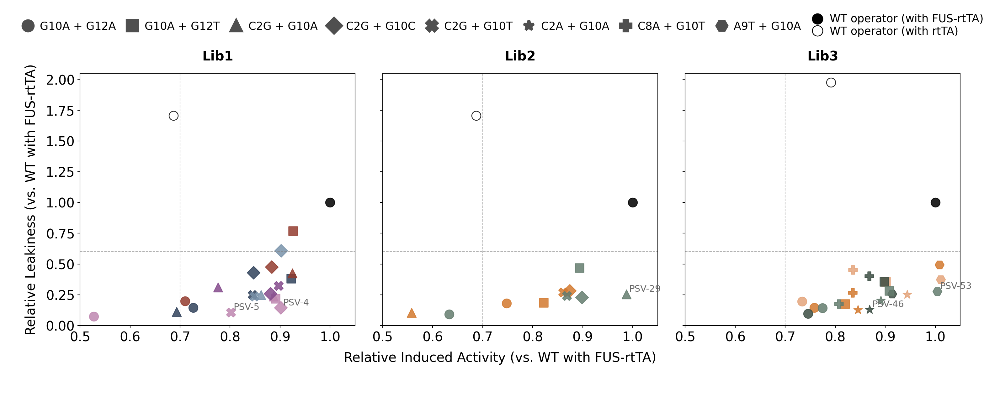

# PhaseSep

*qxdu edited on Nov 19, 2026*

The code for computational implementation of "Coordinated Cis–Trans Engineering Enables Tight Control of Tetracycline-Inducible Gene Expression".

# Introduction

Tetracycline-inducible systems are among the most widely used inducible systems in mammalian cells, and their persistent limitation is basal expression in the absence of inducer, commonly called leakiness. PhaseSep addresses the switch on both sides at once. A phase-separating intrinsically disordered region (FUS) is fused to the N-terminus of the reverse tetracycline transactivator to strengthen transactivation, and the cis-regulatory grammar of the tetracycline-responsive element (TRE) is optimized with a dual-condition MPRA read by a deep learning model. The lead variants lowered leakiness to 12.7% of the canonical system while raising induced activity to 121%, and suppressed inducer-independent cytotoxicity in an HSV-TK/ganciclovir assay while retaining doxycycline-induced killing.

This repository holds the code behind the paper's designs and figures: construction of the round-1 MPRA library, the analysis of the reporter and MPRA measurements behind Fig. 1B–G and Fig. 2A–B, the library analyses of Supplementary Figs. 1–7, the AttnBiLSTM sequence-to-function models and their ten-architecture benchmark (Supplementary Figs. 8–10), and the three rounds of in silico design of candidate TREs.



**Figure 2A.** Relative induced activity and relative leakiness of the three designed candidate libraries. Candidates of Lib1 (5–6 operators), Lib2 (7–8 operators) and Lib3 (7–8 operators, UCB-guided) were transactivated by FUS-rtTA and measured by flow cytometry. The filled circle is the standard TRE transactivated by FUS-rtTA and the open circle the standard TRE transactivated by canonical rtTA; both set the relative scale. Syntax configurations are colour-coded, individual operator variants differ in marker shape, and the dotted lines mark a relative activity of 0.7 and a relative leakiness of 0.6.

# Quick Start

The code runs in four stages, each made of standalone scripts that read `./data` and write into the repository:

1. **Library construction** (`R01_*.py`): train the DeepSEED generator on HEK293T enhancers, generate the component libraries and assemble the 18,000-design round-1 library that went to MPRA.
2. **Figure reproduction** (`F01*.py`, `F02*.py`, `S01`–`S07`): each figure reads the measured tables under `./data` and writes png, svg and pdf into `./figs`.
3. **Model training and benchmarking** (`S08_*.py`, `S09_*.py`, `S10_tetO_contributions.py`): the AttnBiLSTM predictor, the ten-architecture comparison and the per-operator attribution.
4. **Design rounds** (`R02_*.py`, `R03_round3_design.py`): the three candidate libraries measured in Fig. 2A.

## Reproducing the Figures

Each figure script is self-contained. Run it from the repository root:

```
python F01e_single_mutagenesis_heatmap.py
python S05_double_mutant_heatmap.py
```

Each script writes its figure into `./figs` as png, svg and pdf, under the stem the script sets. The inputs of each script are listed in the Figure Summary below.

## Training and Benchmarking the Models

`S09_train_model.py` trains the AttnBiLSTM predictor on a fixed 90/10 split of the round-1 library and writes the split and the three branch checkpoints; `S09_model_evaluation.py` scores the held-out tenth and draws Supplementary Fig. 9. `S08_train_models.py` trains the other nine architectures on the same split into `./checks/round1_archs/`, and `S08_model_evaluation.py` draws the 20 × bootstrap comparison of Supplementary Fig. 8. Training needs a GPU; the figure scripts run on CPU.

## Designing the Candidate Libraries

`R01_round1_predictor.py` trains the three-branch predictor on the whole round-1 library, and the two design rounds score their candidates with it. `R02_round2_design.py` screens the round-1 syntax results, picks the spacer templates and the best double-mutant operators, fills the flanking sequences with DeepSEED and with random draws, and keeps one design per template. Its two extensions cover the higher operator counts and a six-operator control. `R03_round3_design.py` repeats the design with ten bootstrap members of the ensemble and an Upper Confidence Bound screen.

# Preparation

## Environment Setup

```
Python     3.9
numpy, pandas, matplotlib, seaborn, scipy, scikit-learn, joblib, tqdm
torch      2.5.1, CUDA 12.1 (training; the figure scripts run on CPU)
openpyxl   read of the .xlsx inputs
xlrd       read of data/cgan_template/TetO_mutant.xls
```

Every figure is written as png (300 or 600 dpi), svg and pdf, with TrueType fonts embedded (`pdf.fonttype` 42).

## Data Summary

The MPRA tables are per-sequence activity and are named by transactivator and condition: `FUS_TO` is the FUS-rtTA system, `TO` the canonical rtTA system, and `induced` / `uninduced` the +Dox / −Dox condition. The replicate tables carry the two biological replicates, the mean tables one mean per sequence.

| File | Content |
|---|---|
| `data/7_exp_rep{1,2}_FUS_TO_{induced,uninduced}.tsv` | Round-1 MPRA, FUS-rtTA system, two replicates per condition |
| `data/7_exp_rep{1,2}_TO_{induced,uninduced}.tsv` | The same four tables for the canonical rtTA system |
| `data/7_exp_mean_FUS_TO_{induced,uninduced}.tsv` | Per-sequence means of the round-1 library, FUS-rtTA system |
| `data/7_exp_mean_TO_{induced,uninduced}.tsv` | The same for the canonical rtTA system |
| `data/F1_IDR_activity.csv` | Reporter activity of the IDR–rtTA panel, Fig. 1B |
| `data/F1_dox responsive curve plot.xlsx` | Doxycycline dose–response, Fig. 1C |
| `data/F4_double_mutant_activity.csv` | Reporter activity of the double mutants, Fig. 1F |
| `data/reporter_argmax.xlsx` | Measured Lib1 and Lib2 candidates, Fig. 2A |
| `data/reporter_ucb.xlsx` | Measured Lib3 candidates, Fig. 2A |
| `data/toxic_gene_expression_raw_data_V7.csv` | HSV-TK/ganciclovir viability, Fig. 2B |
| `data/cgan_template/` | The four templates the designs are built from, and the published positive controls |
| `data/cgan_train/` | HEK293T enhancers for the DeepSEED model and the motif-filtered control set |
| `data/predictor_train/` | Sequence table of the round-1 predictor |

## Figure Summary

| Script | Figure | Input | Content |
|---|---|---|---|
| `F01b_IDR_activity_2panels_vertical.py` | Fig. 1B | `F1_IDR_activity.csv` | IDR–rtTA reporter activity, induced and uninduced |
| `F01c_dox_responsive_curve.py` | Fig. 1C | `F1_dox responsive curve plot.xlsx` | Doxycycline dose–response with the Hill fit |
| `F01e_single_mutagenesis_heatmap.py` | Fig. 1E | replicate tables | Single-substitution landscape of the 19 bp tetO |
| `F01f_double_mutant_activity_plot_vertical.py` | Fig. 1F | `F4_double_mutant_activity.csv` | Reporter activity of the designed double mutants |
| `F01g_syntax_activity_vertical.py` | Fig. 1G | mean tables | Six-operator activity across inter-operator distance |
| `F02a_reporter_assay_all_colour_V4.py` | Fig. 2A | `reporter_argmax.xlsx`, `reporter_ucb.xlsx` | Relative activity and leakiness of Lib1–Lib3 |
| `F02c_toxic_gene_expression_plot_V7.py` | Fig. 2B | `toxic_gene_expression_raw_data_V7.csv` | Cell viability under HSV-TK/ganciclovir |
| `S01_library_construction.py` | Supp. Fig. 1 | mean tables, `final_library.csv` | Designed syntax grid with marginals |
| `S02_representation_tsne.py` | Supp. Fig. 2 | mean tables, Evo2 and Sei embeddings | t-SNE of the library in both representations |
| `S03_replicate_scatter.py` | Supp. Fig. 3 | replicate tables | Biological replicate concordance, four conditions |
| `S04_mutant.py` | Supp. Fig. 4 | mean tables | Position-wise single-mutation effects, three figures |
| `S05_double_mutant_heatmap.py` | Supp. Fig. 5 | replicate tables | Double-mutation heatmaps over position pairs |
| `S06_gap_distribution_fourier.py` | Supp. Fig. 6 | mean tables | Activity across distances and its Fourier spectrum |
| `S07_operator_number_vs_distance.py` | Supp. Fig. 7 | mean tables | Operator number at 17, 20 and 21 bp |
| `S08_train_models.py`, `S08_model_evaluation.py` | Supp. Fig. 8 | `preds/S08_training_data/` | Ten-architecture benchmark on the held-out tenth |
| `S09_train_model.py`, `S09_model_evaluation.py` | Supp. Fig. 9 | training split | Held-out prediction and NDCG@K of the AttnBiLSTM |
| `S10_tetO_contributions.py` | Supp. Fig. 10 | mean tables, round-1 predictor | Per-operator SmoothGrad attribution, six panels |

## Design Summary

| Script | Stage | Writes |
|---|---|---|
| `R01_round1_prepare_lib_train.py` | DeepSEED generator, trained on HEK293T enhancers | `./checks/cgan_hek293t/` |
| `R01_round1_prepare_lib_generate.py` | The seven component libraries | `./results/round1_library/*.csv` |
| `R01_round1_prepare_lib_combine.py` | The 18,000-design library | `./results/round1_library/final_library.{csv,txt}` |
| `R01_round1_predictor.py` | Round-1 predictor, three branches | `./checks/round1_design/`, `./data/predictor_train/` |
| `R02_round2_design.py` | Round-2 design, 5–6 operators (Lib1) | `./results/round2_design/` |
| `R02_round2_design_ext1_stack.py` | Round-2 extension, seven operators and above (Lib2) | `./results/round2_design_ext1_stack/` |
| `R02_round2_design_ext2_6tetO.py` | Round-2 extension, six-operator control | `./results/round2_design_ext2_6tetO/` |
| `R03_round3_design.py` | Round-3 design, ensemble and UCB (Lib3) | `./results/round3_design/` |

## Model Summary

The ten architectures of Supplementary Fig. 8 are implemented in `./scripts`, one module each.

| Architecture | Module | Note |
|---|---|---|
| AttnBiLSTM | `lib_attnbilstm.py` | The paper's predictor; trained by `S09_train_model.py` |
| DeepSTARR2 | `lib_deepstarr2.py` | |
| DeepGOPlus | `lib_deepgoplus.py` | |
| Malinois | `lib_malinois.py` | |
| LegNet | `lib_legnet.py` | |
| DeepCROSS | `lib_deepcross.py` | |
| DenseNet | `lib_densenet.py` | |
| DenseLSTM | `lib_denselstm.py` | |
| ResNet-HW | `lib_resnethw.py` | |
| ResNet-WY | `lib_resnetwy.py` | |

`lib_nnmodel.py` holds the dataset classes and a default model wrapper; it is not one of the ten compared.

## Repository Layout

```
.
├── F01b … S10_…            the analysis and figure scripts, listed above
├── R01_ … R03_ …           the library construction and design rounds
├── _cgan_arch.py           the DeepSEED generator and discriminator
├── _cgan_common.py         its data, decoding and bookkeeping
├── _model.py               the AttnBiLSTM architecture
├── _utils.py               sequence and table helpers
├── data/                   inputs, all tracked
├── figs/                   figure outputs, png / svg / pdf
├── preds/                  embeddings, training splits and model predictions
├── results/                round-1, round-2 and round-3 design outputs
└── scripts/                the ten benchmark architectures, lib_*.py
```

# Resources

```
GitHub repository: https://github.com/WangLabTHU/PhaseSep
```

The repository ships the analysis code, the MPRA tables and the per-figure outputs. The checkpoints are regenerated by the training scripts above, and the two embedding matrices follow the procedure in the Methods.

# Citations

```
[1] Zhang, P. et al. Deep flanking sequence engineering for efficient promoter design using DeepSEED. Nat. Commun. 14, 6309 (2023).
[2] Chen, K. M., Wong, A. K., Troyanskaya, O. G. & Zhou, J. A sequence-based global map of regulatory activity for deciphering human genetics. Nat. Genet. 54, 940–949 (2022).
[3] Kulmanov, M. & Hoehndorf, R. DeepGOPlus: improved protein function prediction from sequence. Bioinformatics 36, 422–429 (2020).
[4] de Almeida, B. P. et al. Targeted design of synthetic enhancers for selected tissues in the Drosophila embryo. Nature 626, 207–211 (2024).
[5] Gosai, S. J. et al. Machine-guided design of cell-type-targeting cis-regulatory elements. Nature 634, 1211–1220 (2024).
[6] Agarwal, V. et al. Massively parallel characterization of transcriptional regulatory elements. Nature 639, 411–420 (2025).
[7] Zhang, P., Du, Q., Wang, Y., Wei, L. & Wang, X. Systematic representation and optimization enable the inverse design of cross-species regulatory sequences in bacteria. Nat. Commun. 16, 1763 (2025).
[8] Huang, G., Liu, Z., van der Maaten, L. & Weinberger, K. Q. Densely connected convolutional networks. CVPR 2017, 2261–2269.
[9] Li, J. et al. Modeling and designing enhancers by introducing and harnessing transcription factor binding units. Nat. Commun. 16, 1469 (2025).
[10] He, K., Zhang, X., Ren, S. & Sun, J. Deep residual learning for image recognition. CVPR 2016, 770–778.
[11] Vaishnav, E. D. et al. The evolution, evolvability and engineering of gene regulatory DNA. Nature 603, 455–463 (2022).
[12] Du, Q., Wang, H., Jiang, B. & Wang, X. Advancing genetic engineering with active learning: theory, implementations and potential opportunities. Brief. Bioinform. 26, bbaf286 (2025).
```
